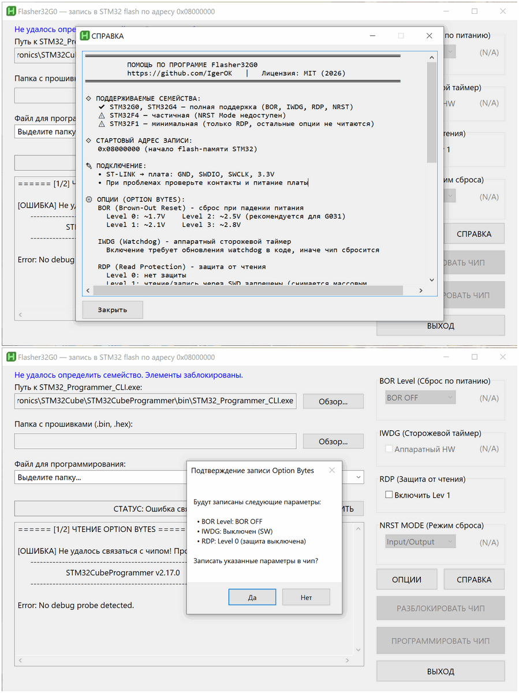

# Flasher32G0

**GUI-утилита для прошивки STM32 и настройки Option Bytes через STM32CubeProgrammer CLI**

**Current version: 1.1**

[](https://opensource.org/licenses/MIT)
[](https://www.autohotkey.com/)
[](https://www.microsoft.com/windows)

Программа предоставляет удобный графический интерфейс для программирования микроконтроллеров STM32 через утилиту STM32CubeProgrammer CLI. Позволяет не только прошивать flash-память, но и настраивать Option Bytes (BOR, IWDG, RDP, NRST MODE) без необходимости запоминать синтаксис командной строки.

## 📸 Скриншот



## 🚀 Возможности

- 🔍 **Автоматическое определение семейства чипа** — поддержка STM32G0, G4, F4, F1
- ⚙️ **Настройка Option Bytes**:
  - BOR (Brown-Out Reset) — сброс при падении питания
  - IWDG (Independent Watchdog) — аппаратный сторожевой таймер
  - RDP (Read Protection) — защита от чтения (Level 0/1, Level 2 запрещён)
  - NRST MODE — режим работы ноги сброса (G0/G4)
  - BOOT0 — распознавание пина CLKSWD (nBOOT_SEL=0, legacy, G0/G4): при активации выбор загрузки (user code / UART-bootloader) определяется уровнем пина, который задаёт пользователь джампером
- 📁 **Программирование flash** — запись файлов .bin / .hex по адресу 0x08000000
- 🔧 **Только Option Bytes** — возможность записать только настройки без перезаписи flash
- 🔓 **Разблокировка чипа** — снятие защиты RDP Level 1 (массовое стирание)
- 📝 **Предпросмотр изменений** — окно подтверждения с показом параметров перед записью
- 💾 **Сохранение настроек** — запоминает путь к CLI, папку с прошивками и геометрию окна
- 📐 **Адаптивный интерфейс** — окно изменяет размер, элементы подстраиваются
- 🧾 **Логирование** — подробный вывод всех операций в текстовое поле

## 📋 История версий

### v1.1 (2026)
Отличия от v1.0:
- **Добавлена настройка BOOT0 (System Bootloader) для STM32G0/G4** — опшен-байт
  `nBOOT_SEL`: включение чекбокса даёт возможность прошивки по UART
  (через System Memory Bootloader), управление пин CLKSWD (джампер +
  резистор 10к к GND); при выключении — только SWD.
- **Справка и предупреждения** дополнены: примечания по BOR
  (внешний супервизор, уровень 4.5В для LDO, диод Шоттки для
  не-open-drain выхода), по NRST (конденсатор опционален, 1000 пкФ),
  по IWDG (авто-старт после сброса, требует «кормления», отключается
  только перезаписью опшен-байтов).
- Исправлено отображение подписи IWDG (обрезание текста).
- Увеличена высота окна, добавлена группа BOOT0 в правую панель.

### v1.0
- Первая версия: чтение/запись Option Bytes (BOR, IWDG, RDP, NRST MODE),
  программирование flash (.bin/.hex по адресу 0x08000000), разблокировка
  чипа (RDP Level 1), автоопределение семейства, предпросмотр,
  сохранение настроек, адаптивный GUI.

## 📥 Требования

### Для запуска .exe (рекомендуется)
- Windows 7 / 8 / 10 / 11 (x86/x64)
- [STM32CubeProgrammer](https://www.st.com/en/development-tools/stm32cubeprog.html) (CLI-версия)

### Для запуска .ahk (исходный код)
- Windows 7 / 8 / 10 / 11
- [AutoHotkey v2](https://www.autohotkey.com/) (установленная или портативная версия)
- [STM32CubeProgrammer](https://www.st.com/en/development-tools/stm32cubeprog.html) (CLI-версия)

> 💡 **Примечание:** .exe версия собрана для x32, но отлично работает и на x64 системах.

## 🚀 Установка и запуск

### Вариант 1: Скомпилированный .exe (проще всего)
1. Скачайте `Flasher32G0.exe` из репозитория
2. Запустите двойным щелчком
3. При первом запуске укажите путь к `STM32_Programmer_CLI.exe`

### Вариант 2: Исходный скрипт (требуется AutoHotkey v2)
```bash
git clone https://github.com/IgerOK/Flasher32G0.git
cd Flasher32G0
.\Flasher32G0.ahk
```

## 🚀 Первый запуск

### Шаг 1: Запуск программы
- Дважды щёлкните по `Flasher32G0.exe` (или `Flasher32G0.ahk`, если используете AutoHotkey)
- При необходимости подтвердите запрос прав администратора (требуется для доступа к ST-LINK)

### Шаг 2: Указание пути к STM32CubeProgrammer
- Если программатор не найден автоматически, поле "Путь к STM32_Programmer_CLI.exe" будет пустым
- Нажмите кнопку **Обзор...** справа от поля
- Найдите и выберите файл `STM32_Programmer_CLI.exe` (обычное расположение: `C:\Program Files\STMicroelectronics\STM32Cube\STM32CubeProgrammer\bin\STM32_Programmer_CLI.exe`)

- Путь сохранится автоматически и будет использоваться при следующих запусках

### Шаг 3: Выбор папки с прошивками
- Нажмите кнопку **Обзор...** под полем "Папка с прошивками (.bin, .hex)"
- Выберите директорию, где лежат ваши скомпилированные файлы прошивки (`.bin` или `.hex`)
- После выбора папки выпадающий список "Файл для программирования" автоматически заполнится найденными файлами

> 💡 **Совет:** Если вы используете Arduino IDE с настроенным `build.path`, укажите папку `_build_hex_bin` — в неё IDE автоматически складывает результаты компиляции.

### Шаг 4: Подключение чипа
- Подключите ST-LINK к компьютеру через USB
- Соедините ST-LINK с платой STM32 по 4 проводам (GND, SWDIO, SWCLK, 3.3V)
- Убедитесь, что плата получает питание (индикатор на плате горит)

### Шаг 5: Чтение информации о чипе
- Нажмите кнопку **ОБНОВИТЬ**
- В поле статуса отобразится "СТАТУС: Чтение Option Bytes..."
- Через несколько секунд программа определит семейство чипа (G0, G4, F4, F1)
- В правой панели появятся текущие значения Option Bytes


## 📖 Руководство по использованию

### 1. Чтение Option Bytes
- Нажмите кнопку **ОБНОВИТЬ**
- Программа определит семейство чипа и отобразит текущие настройки
- В правой панели появятся текущие значения параметров

### 2. Настройка Option Bytes
- Выберите нужные значения в выпадающих списках и чекбоксах
- Нажмите кнопку **ОПЦИИ**
- Ознакомьтесь с предпросмотром изменений и подтвердите запись

### 3. Прошивка flash-памяти
- Выберите файл прошивки (.bin или .hex) из выпадающего списка
- Нажмите кнопку **ПРОГРАММИРОВАТЬ ЧИП**
- Дождитесь завершения процесса (статус отображается в строке состояния)

### 4. Разблокировка чипа (снятие RDP Level 1)
- Если чип заблокирован, нажмите кнопку **РАЗБЛОКИРОВАТЬ ЧИП**
- Произойдёт массовое стирание flash-памяти и сброс защиты до Level 0

### 5. Получение справки
- Нажмите кнопку **СПРАВКА** для отображения подробной информации
- Текст в окне справки можно выделять и копировать

## 🛠️ Поддерживаемые семейства

| Семейство | BOR | IWDG | RDP | NRST | BOOT0 | Примечание |
|-----------|:---:|:----:|:---:|:----:|:-----:|-------------|
| **STM32G0** | ✔️ | ✔️ | ✔️ | ✔️ | ✔️ | Полная поддержка |
| **STM32G4** | ✔️ | ✔️ | ✔️ | ✔️ | ✔️ | Полная поддержка |
| **STM32F4** | ✔️ | ✔️ | ✔️ | ❌ | ❌ | NRST Mode и BOOT0 недоступны |
| **STM32F1** | ❌ | ❌ | ✔️ | ❌ | ❌ | Только RDP |

> ℹ️ При подключении чипа других семейств программа попытается прочитать Option Bytes, но некоторые опции могут быть недоступны.

## ⚙️ Описание Option Bytes

### BOR (Brown-Out Reset) — сброс при падении питания
Автоматически сбрасывает чип, когда напряжение питания падает ниже заданного порога. Рекомендуется включать для защиты от нестабильной работы.

| Уровень | Напряжение | Применение |
|---------|------------|------------|
| BOR OFF | - | Сброс отключён |
| Level 0 | ~1.7V | Очень низкий порог |
| Level 1 | ~2.1V | Низкий порог |
| Level 2 | ~2.5V | Оптимальный порог |
| Level 3 | ~2.8V | Высокий порог |

> 💡 **Примечание:** при медленном нарастании питающего напряжения код
>   может не запуститься (BOR не сработает). Устраняется внешним
>   супервизором. Лучший вариант — контроль супервизором **входного**
>   напряжения стабилизатора 3.3В: оптимальный уровень 4.5В для
>   LDO-стабилизатора — корректный сброс всегда на плато 3.3В
>   питающего напряжения.
>
>   Если выход супервизора **НЕ open-drain** — добавить диод
>   (Шоттки или обычный) **анодом к NRST**, катодом — к выходу
>   супервизора.

### IWDG (Independent Watchdog) — сторожевой таймер
- **Выключен (SW)** — watchdog управляется программно
- **Активен (HW)** — аппаратный watchdog, требует периодического сброса в коде, иначе чип перезагружается

> ⚠️ При включении HW watchdog убедитесь, что ваша прошивка содержит команды обновления таймера!

### RDP (Read Protection) — защита от чтения
- **Level 0** — защиты нет, чтение/запись через SWD разрешены
- **Level 1** — чтение/запись через SWD заблокированы, снимается массовым стиранием (кнопка РАЗБЛОКИРОВАТЬ)
- **Level 2** — 🔴 **НЕОБРАТИМО!** Чип навсегда блокируется, программирование становится невозможным. НИКОГДА не устанавливайте!

### NRST MODE (G0/G4) — режим работы ноги сброса
- **Input/Output** (рекомендуется) — нога работает как обычный GPIO или вход сброса
- **Reset Input Only** — нога работает только как вход сброса

> 💡 **Примечание по плате:** конденсатор 0,1 мкФ на пине NRST можно НЕ
>   устанавливать. При необходимости — поставить конденсатор меньшего
>   номинала **1000 пкФ** около пина для лучшей помехозащищённости.

### BOOT0 (G0/G4) — распознавание пина CLKSWD
Управляется опшен-байтом `nBOOT_SEL` (`nBOOT0` — заводское, не трогаем).
**Чекбокс в программе — осознанный выбор пользователя: он лишь ОТКРЫВАЕТ
ВОЗМОЖНОСТЬ** прошиться либо по SWD, либо по UART (программа только пишет
опшен-байты и не управляет пинами).

| Состояние чекбокса | `nBOOT_SEL` | Что это значит |
|--------------------|-------------|----------------|
| Не активирован | `1` | Пин CLKSWD игнорируется. Прошивка/отладка **только по SWD** (заводской режим). |
| Активирован | `0` | Пин CLKSWD распознаётся: его **уровень определяет**, куда загрузится чип. |

**При `nBOOT_SEL=0` — выбор по уровню пина CLKSWD (задаёт пользователь до
подачи питания):**

- **CLKSWD=0** — старт из **Main Flash** (свой код), SWD доступен.
- **CLKSWD=1** — старт в **System Memory** (bootloader): прошивка по UART
  (COM-порт) ИЛИ по SWD (ST-LINK).

Рекомендации по плате:
- Для UART (CLKSWD=1) — подтянуть пин джампером к VCC (+3.3V).
- Рекомендуется постоянный резистор **10к из CLKSWD в GND** (подтяжка на
  землю, чтобы по умолчанию оставалось CLKSWD=0 и не было ложных
  срабатываний).

**Запуск своего кода после прошивки (при активном чекбоксе):**
1. **Снимаем джампер с плюса питания (VCC)** — пин CLKSWD вернётся в
   состояние 0 (через резистор 10к к земле).
2. **Перезагружаем чип** (RESET / перекл. питания).
3. Стартует пользовательский код.

> ⚠️ При `nBOOT_SEL=0` и CLKSWD=1 чип загружается в **bootloader**, а не в
>   вашу прошивку. Чтобы запустить свой код — **снимите джампер** (пин через
>   10к к GND → CLKSWD=0) и перезагрузите. По желанию затем можно полностью
>   отключить распознавание пина (снять чекбокс, `nBOOT_SEL=1`).
>
> 💡 Для прошивки по UART без ST-LINK: подключите USB-serial адаптер
>    (TX→RX, RX→TX, GND), установите CLKSWD=1 (джампер к VCC) и используйте
>    `STM32_Programmer_CLI -c port=UART -e all -w fw.bin 0x08000000 -v`.

## ⚠️ Важные предупреждения

| Опция | Риск | Рекомендация |
|-------|------|--------------|
| **RDP Level 2** | 🔴 **НЕОБРАТИМО!** Чип навсегда превращается в "кирпич" | **НИКОГДА** не устанавливайте |
| **IWDG (HW)** | 🟡 Требует поддержки в прошивке | Убедитесь, что код обновляет watchdog |
| **RDP Level 1** | 🟡 Блокирует SWD | Разблокируется массовым стиранием |
| **BOR Level 3** | 🟡 Высокий порог (~2.8V) | Может вызывать ложные сбросы |

### Для STM32G031F8P6 в Arduino IDE:
- Если вы не используете USART, можно отключить **USART Support** в настройках платы
- Это экономит память и освобождает пины PA9/PA10 для других целей

### Перед программированием:
- Всегда нажимайте **ОБНОВИТЬ**, чтобы убедиться, что чип не заблокирован RDP Level 1
- Проверьте правильность подключения ST-LINK (4 провода: GND, SWDIO, SWCLK, 3.3V)

## 🔧 Устранение неполадок

### "Не удалось связаться с чипом!"
- Проверьте подключение ST-LINK к плате (4 провода)
- Убедитесь, что плата получает питание (3.3V)
- Попробуйте переподключить ST-LINK к USB

### "STM32CubeProgrammer не найден"
- Установите STM32CubeProgrammer с официального сайта STMicroelectronics
- Укажите путь к `STM32_Programmer_CLI.exe` вручную через кнопку **Обзор...**

### Option Bytes не записываются (предупреждение "unchanged")
- Это не ошибка — программа просто сообщает, что параметры уже соответствуют желаемым
- Измените какой-нибудь параметр (например, BOR) для проверки записи

### Окно справки не открывается
- Убедитесь, что скрипт запущен от имени администратора
- Закройте программу и запустите снова

### RDP Level 1 не снимается
- Нажмите кнопку **РАЗБЛОКИРОВАТЬ ЧИП** — произойдёт массовое стирание
- После разблокировки чип будет полностью стёрт (flash очищен)

## 🔗 Ссылки

- [STM32CubeProgrammer (официальный сайт)](https://www.st.com/en/development-tools/stm32cubeprog.html)
- [AutoHotkey v2](https://www.autohotkey.com/)
- [Репозиторий на GitHub](https://github.com/IgerOK/Flasher32G0)

## 📝 Лицензия

MIT © 2026 [IgerOK](https://github.com/IgerOK)

Подробности в файле [LICENSE](LICENSE)

---

⭐ Если этот проект оказался полезным, поставьте звёздочку на GitHub!

